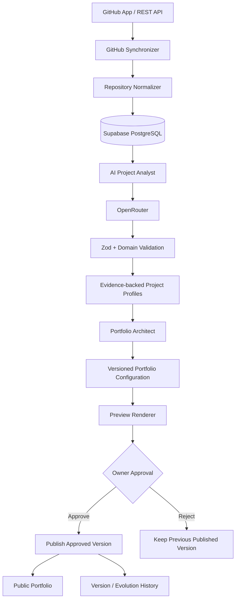

# MorphFolio — System Architecture

**Status:** Architecture baseline  
**Pattern:** Modular monolith, SaaS-ready boundaries

## 1. Technology decisions

| Concern | Decision | Notes |
|---|---|---|
| Web application | Next.js App Router | Server-first React application |
| Language | TypeScript | Strict mode |
| Styling | Tailwind CSS | Design tokens and responsive UI |
| UI primitives | shadcn/ui + Radix | Accessible, composable components |
| Icons | Lucide | Consistent icon set |
| Motion | Motion | Use sparingly and respect reduced-motion |
| Database | Supabase PostgreSQL | Persistent domain data |
| Authentication | Supabase Auth | Owner/admin authentication |
| GitHub | GitHub App + REST API | Read-only permissions initially |
| AI gateway | OpenRouter | Provider/model abstraction |
| AI SDK | Vercel AI SDK + OpenRouter provider | Typed model calls |
| Validation | Zod | Runtime boundary validation |
| Automation | GitHub Actions | CI and scheduled jobs initially |
| Tests | Vitest + Playwright | Unit/integration and browser E2E |
| Hosting | Vercel | Initial hosting target |
| Error monitoring | Sentry (later) | Add when production needs justify it |

## 2. High-level architecture

## 3. Architectural boundaries

### GitHub module
Owns GitHub App authentication, installation discovery, repository listing, repository selection, API pagination, rate-limit handling, and webhook verification.

### Intelligence module
Owns prompt construction, model selection, structured generation, evidence extraction, confidence metadata, retries, and AI cost accounting.

### Portfolio module
Owns project profiles, layout policies, design preferences, rendering configuration, and public portfolio queries.

### Evolution module
Owns run lifecycle, idempotency, proposals, approvals, publication, audit history, and rollback.

### Database module
Owns Supabase server client construction, typed queries, migrations, and access policies.

## 4. AI boundary

The AI returns typed domain data. It does not return executable JSX, JavaScript, CSS, SQL, shell commands, or arbitrary code. All AI output is treated as untrusted input.

The pipeline is:

1. Build a bounded evidence packet from selected repository data.
2. Call the configured OpenRouter model.
3. Parse structured output.
4. Validate with Zod.
5. Apply deterministic rules and evidence checks.
6. Persist a draft proposal.
7. Require owner review before publication.

## 5. Data flow and consistency

- Synchronization writes normalized repository snapshots with source timestamps.
- Analysis runs are idempotent for a repository revision and prompt/schema version.
- Project profiles are versioned or auditable.
- A portfolio configuration has draft, approved, and published states.
- A failed run never overwrites the current published configuration.
- Public rendering reads only approved published configuration and explicitly public project fields.

## 6. Background execution

Initial execution uses GitHub Actions for scheduled/manual synchronization and CI. Webhooks may trigger a secured application endpoint later. Do not rely on a long-running request inside a serverless route for an unbounded batch.

For larger workloads, introduce a durable queue only when measured execution duration, retries, or concurrency require it.

## 7. Environment configuration

Document variable names in `.env.example`. Expected server-only variables include:

- `NEXT_PUBLIC_SUPABASE_URL`
- `NEXT_PUBLIC_SUPABASE_ANON_KEY` (or publishable key where applicable)
- `SUPABASE_SERVICE_ROLE_KEY` (server only; never expose to browser)
- `OPENROUTER_API_KEY`
- `OPENROUTER_ANALYSIS_MODEL`
- `OPENROUTER_ARCHITECT_MODEL`
- `GITHUB_APP_ID`
- `GITHUB_APP_PRIVATE_KEY`
- `GITHUB_WEBHOOK_SECRET`
- `GITHUB_CLIENT_ID` and `GITHUB_CLIENT_SECRET` only if required by the selected OAuth flow
- `APP_URL`

Never commit actual values.
