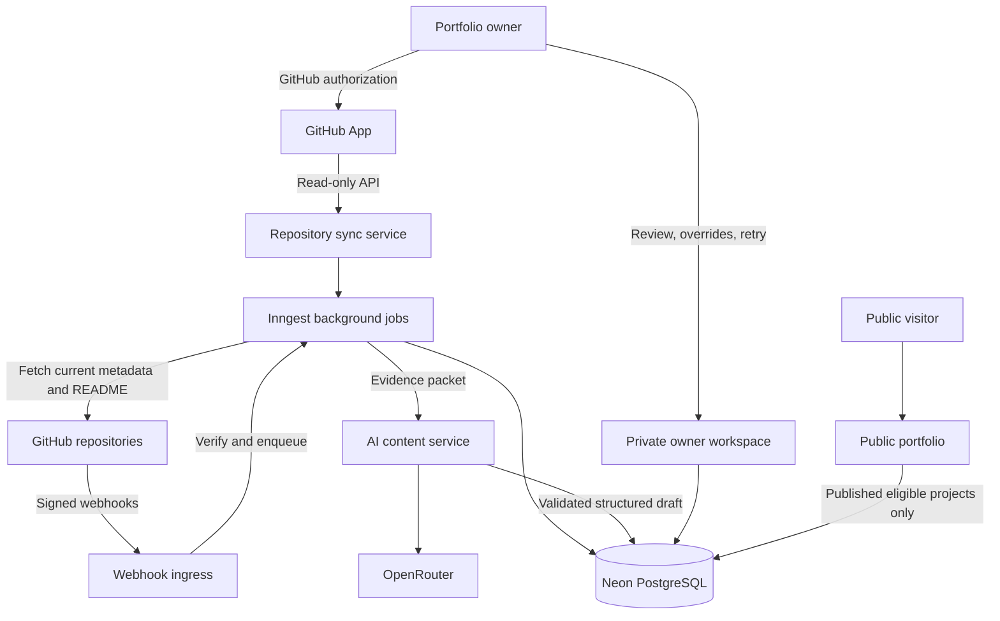

# MorphFolio — System Architecture

**Status:** Approved GitHub-synchronized personal portfolio architecture  
**Pattern:** Modular monolith with durable background jobs

## 1. Product architecture

MorphFolio connects to one owner's GitHub account, discovers repositories, monitors relevant repository changes, analyzes README and bounded metadata with AI, and maintains a public developer portfolio.

The application has two surfaces:
- **Public portfolio:** crawlable pages containing owner-approved profile information and published project records.
- **Private owner workspace:** GitHub connection, repository inclusion/exclusion, first-publication review, field overrides, sync health, and retry controls. Access is restricted to the configured GitHub owner identity.

GitHub is authoritative for repository identity, README content, repository metadata, and lifecycle. MorphFolio's database stores synchronization state, evidence snapshots, generated content, owner overrides, publication state, and audit history. The AI provider is not a source of truth.

New repositories require approval before first publication. Validated updates to existing published projects may publish automatically. Manual overrides always take precedence. The last known-good public version remains visible after processing failures.

## 2. Technology decisions

| Concern | Proposed choice | Responsibility |
|---|---|---|
| Web application | Next.js App Router | Public and owner interfaces, server routes |
| Language/UI | TypeScript, React, Tailwind CSS 4 | Application and design system |
| GitHub integration | GitHub App + GitHub REST API | Installation, read-only repository access, webhooks |
| Owner authorization | GitHub App user authorization + owner-login allowlist | Restrict workspace to one owner |
| Database | Neon PostgreSQL | Durable application state |
| ORM | Drizzle ORM | Typed schema and migrations |
| Background jobs | Inngest | Durable sync, AI, retry, reconciliation workflows |
| AI gateway | OpenRouter + Vercel AI SDK | Structured content generation |
| Validation | Zod | Boundary and model-output validation |
| Hosting | Vercel | Next.js application and webhook ingress |
| CI | GitHub Actions | Lint, typecheck, tests, production build |

These are the approved implementation direction for the personal-first product. Revisit a choice only with a concrete technical reason and a documented decision. Do not reintroduce Supabase by default.

## 3. System context

## 4. Runtime boundaries

### GitHub integration
Owns GitHub App authorization/install lifecycle, token generation, repository pagination, read-only API access, webhook signature verification, delivery deduplication, and repository identity mapping. Use immutable GitHub repository IDs as stable external identifiers. Never trust webhook payloads as the final current repository state; re-fetch from GitHub.

### Webhook ingress
Verify the X-Hub-Signature-256 HMAC using the configured webhook secret, validate event type/action and delivery ID, persist a minimal event record, enqueue durable work, and return promptly. Do not call the AI provider or perform full repository synchronization inside the request.

### Synchronization domain
Fetch repository metadata and README from the default branch. Compare README blob SHA and relevant metadata with the last successful snapshot. A source-code push with unchanged README and metadata must not trigger AI generation. Handle rename, archive, visibility changes, deletion, access loss, and installation suspension.

### Intelligence domain
Build bounded evidence packets, call the configured model, validate structured output, verify evidence references, and return a versioned draft. Repository content is untrusted. Models receive no tools, secrets, code execution, or GitHub write capability.

### Publication domain
Apply publication state transitions, merge generated fields with owner overrides, atomically publish valid versions, and preserve the last known-good version on failure. New repositories stay pending review until explicitly approved.

### Data access
All database access is server-side. Public queries must enforce published status and repository eligibility in the query layer, not only in UI conditionals. Owner operations require authorization on every request.

## 5. Repository lifecycle and events

Subscribe to the minimum webhook events needed:
- installation and installation_repositories for installation and repository access changes.
- repository for created, edited, renamed, archived, unarchived, deleted, publicized, privatized, and other relevant lifecycle actions.
- push for default-branch README/metadata change detection.
- release only if release metadata is used in generated content.

For every delivery:
1. Verify signature against raw request bytes.
2. Validate event/action and delivery ID.
3. Insert delivery ID under a unique constraint.
4. Enqueue a durable job.
5. Return success quickly.

Jobs must be idempotent. Coalesce bursts of pushes by repository and re-fetch the latest default-branch state. Use periodic reconciliation to compare GitHub's current installation repository list with stored records and recover missed webhooks.

## 6. Initial import and ongoing updates

### First connection
1. Authorize the owner and install the GitHub App on the intended personal account.
2. Enumerate all repositories accessible to the installation with pagination.
3. Persist repository identity and metadata.
4. Mark private repositories as non-public and do not submit their contents to external AI unless explicitly enabled.
5. Match existing hardcoded portfolio projects to repositories by verified repository URL/immutable ID. Preserve their current published content during migration.
6. Analyze unmatched eligible repositories and create pending-review drafts.

### New repository
Discover → fetch metadata/README → create evidence snapshot → AI generation → validate → pending review → owner approves → publish.

### Existing published repository
Webhook/reconciliation → fetch latest default-branch state → compare content hashes → if relevant change, create evidence snapshot → AI generation → validate → merge non-overridden fields → atomically publish new version.

### Ineligible repository
Private, deleted, disabled, inaccessible, or removed-from-installation repositories are unpublished promptly. Keep a minimal tombstone/audit record to prevent delayed events from resurrecting content. Repository rename preserves the project ID and slug unless the owner explicitly changes it.

## 7. Owner authorization and privacy

Use GitHub App user authorization for the owner workspace and compare the authenticated GitHub login/immutable user ID with a server-side configured owner identity. Use secure, HTTP-only, same-site cookies, CSRF protection for mutations, short-lived sessions, and authorization checks on every owner route/action. No public registration or multi-user account model.

Private repositories may be discovered as metadata records so their status is visible in the private owner workspace. Private README contents are not sent to OpenRouter by default. Private repositories are never eligible for public pages. The owner must explicitly opt in to external AI analysis of a private repository, with a clear disclosure.

## 8. Persistence and consistency

Persist GitHub installation and owner identity, repository records, README/evidence snapshots, AI generation runs, structured drafts, project publication state, current published versions, field-level owner overrides, webhook delivery IDs, background job outcomes, and owner audit events.

Use database transactions for publication transitions. Never expose an incomplete draft as published. Retain the previous published snapshot until the replacement is fully validated and committed.

## 9. AI and cost boundaries

Limit README bytes, evidence item count and excerpt length, repository processing concurrency, model tokens, and per-repository run frequency. Cache by repository ID + default-branch commit/README SHA + prompt version + schema version. Use timeouts, bounded retries with exponential backoff and jitter, provider rate-limit handling, and owner-configurable spend limits.

## 10. Observability and recovery

Track webhook delivery, sync run, AI run, and publication state separately. Provide actionable owner-facing status without exposing secrets or private content. Reconciliation is required; webhooks alone are not a complete consistency strategy. Failed jobs must be retryable, and retries must not duplicate projects or publication versions.

## 11. SaaS boundary

Do not build multi-tenant abstractions, customer billing, or public signup in this phase. Keep domain boundaries and ownership checks explicit so future tenant isolation can be designed deliberately after the personal workflow is validated.
