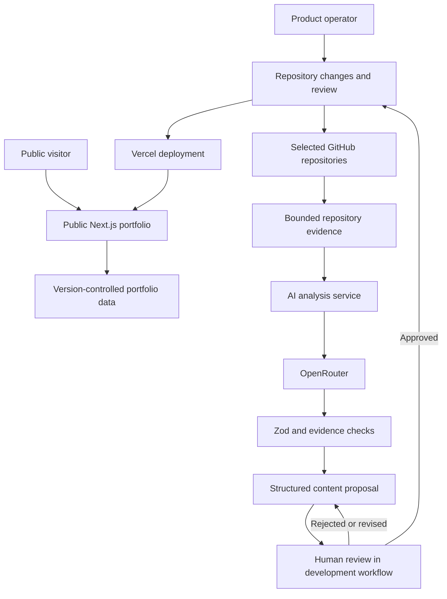

# MorphFolio — System Architecture

**Status:** Personal-first, single-user architecture baseline  
**Pattern:** Modular monolith; no application database or user identity layer in the current release

## 1. Product architecture decision

MorphFolio is the product being developed toward a future SaaS offering. Its current release is built for one person: a public portfolio and its AI-assisted development workflows, with no login, registration, admin dashboard, customer accounts, or multi-tenant infrastructure.

The application is operated through the source repository and Vercel deployment workflow. Portfolio content is typed, version-controlled data. A reviewed Git change is the publication approval; the deployed public site renders the approved content.

Do not add authentication, a database, file storage, or a persistent backend merely because a future SaaS version may need them. Revisit those decisions only when a concrete personal-use workflow requires persistence or when the SaaS phase is explicitly approved.

## 2. Technology decisions
| Concern | Decision | Notes |
|---|---|---|
| Web application | Next.js App Router | Server-first rendering |
| Language | TypeScript | Strict mode |
| Styling | Tailwind CSS 4 | Approved design tokens |
| Icons | Lucide | Consistent iconography |
| Portfolio content | Typed repository data | Versioned through Git |
| AI gateway | OpenRouter | Provider configuration isolated |
| AI SDK | Vercel AI SDK + OpenRouter provider | Typed model calls |
| Validation | Zod | Runtime validation |
| Source evidence | GitHub REST API / selected repositories | Read-only |
| Hosting | Vercel | Production and previews |
| CI | GitHub Actions | Lint, typecheck, production build |

No application database, authentication provider, user session, or file-storage service is part of the current architecture.

## 3. High-level architecture

## 4. Domain boundaries
### Public portfolio
Owns localized public routes, navigation, profile presentation, project listing/detail pages, resume, services, FAQ, contact UI, metadata, and rendering of approved portfolio data.

### Versioned content
Owns typed profile and project data, translations, section configuration, timeline entries, social links, and other public content. Changes are reviewed and deployed through Git. Do not add a CMS or database to solve a workflow that can remain clear in source control.

### GitHub integration
Owns read-only repository discovery, selected repository inspection, pagination, rate-limit handling, and evidence extraction. Keep credentials and installation tokens server-side. Do not grant write permissions for the current release.

### Intelligence
Owns prompt construction, model selection, structured generation, evidence extraction, confidence/risk metadata, independent review, retries, and AI cost accounting. Models receive no write tools, code execution, or secret access. AI output is a proposal, not an automatic publication.

## 5. Content and persistence
- The repository is the source of truth for approved portfolio content.
- The public site reads typed data bundled with the application.
- AI analysis may produce transient proposals; approved changes are committed through the normal development workflow.
- Do not store private evidence, credentials, or generated drafts in public source files.
- Static assets belong in the repository when appropriate; use Vercel-supported asset delivery for public media.
- If a future workflow requires persistent drafts, uploads, background jobs, or user-managed content, document the requirement and compare storage options before selecting a database.

## 6. AI boundary
The AI returns typed content drafts and recommendations, not executable application code. Build a bounded evidence packet, call the configured model, validate output with Zod, verify evidence references, apply deterministic policy checks, and present proposals for human review. Incorporate approved content as a version-controlled change.

Repository content is untrusted and may contain prompt injection. Analysis models receive no tools, GitHub write access, code execution, secrets, or direct publishing permissions.

## 7. Security and operations
- The current public application has no user accounts, login, protected dashboard, or user-specific data.
- Do not add public write endpoints or expose AI provider credentials.
- Keep GitHub App private keys, installation tokens, webhook secrets, and AI API keys server-side.
- Validate external inputs and treat repository content as untrusted.
- Apply request limits, token/cost budgets, timeouts, and bounded retries to AI and GitHub operations.
- Use Git review and CI as the change-control boundary for published content.

## 8. Multilingual model
English is the default locale; French and Spanish are launch locales. Store locale-aware content in typed source data. Missing translations must fall back deliberately to English.

## 9. Future SaaS evolution
A future SaaS release will require a separate architecture decision covering authentication, customer workspaces, tenant isolation, persistent storage, media handling, billing, quotas, abuse controls, backups, and operational support. Choose systems based on validated requirements at that stage; do not build them prematurely.
