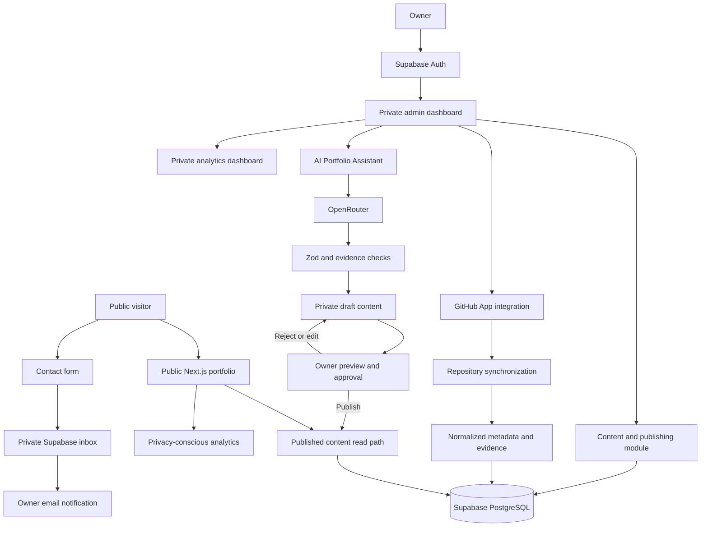

# MorphFolio — System Architecture

**Status:** Personal-first architecture baseline  
**Pattern:** Modular monolith with a single owner and a future-compatible domain boundary

## 1. Product architecture decision

MorphFolio is initially one public personal portfolio with one private owner/admin account. Do not implement public signup, tenant switching, organizations, billing, or customer workspaces.

Keep domain modules and ownership boundaries clean enough that a future multi-user product can be considered separately, but do not add abstractions that only serve hypothetical SaaS requirements.

The public website reads explicitly published portfolio content. The private dashboard manages drafts and published versions. AI and GitHub integrations assist the owner; neither has authority to publish content independently.

## 2. Technology decisions

| Concern | Decision | Notes |
|---|---|---|
| Web application | Next.js App Router | Server-first rendering |
| Language | TypeScript | Strict mode |
| Styling | Tailwind CSS 4 | Semantic design tokens from the approved palette |
| UI primitives | Accessible primitives / Radix where useful | Avoid unnecessary component dependencies |
| Icons | Lucide | Consistent iconography |
| Motion | Lightweight motion library or CSS | Subtle; respect reduced motion |
| Database | Supabase PostgreSQL | Owner-managed content and private operational data |
| Authentication | Supabase Auth | Private owner-only access |
| File storage | Supabase Storage | Portfolio media and CV with explicit policies |
| GitHub | GitHub App + REST API | Read-only initial permissions |
| AI gateway | OpenRouter | Model/provider configuration isolated |
| AI SDK | Vercel AI SDK + OpenRouter provider | Typed model calls |
| Validation | Zod | Runtime validation at boundaries |
| Email | Provider selected before contact-notification implementation | Server-side delivery only |
| Analytics | Privacy-conscious provider selected before analytics phase | Aggregated reporting |
| Tests | Vitest + Playwright | Unit/integration and browser E2E |
| Hosting | Vercel | Production and preview deployments |
| Monitoring | Error monitoring selected for production | Add with operational readiness |

## 3. High-level architecture

## 4. Domain modules

### Public portfolio
Owns localized public routes, navigation, profile presentation, project listing/detail pages, resume, services, FAQ, contact UI, metadata, and published-content queries.

### Content management
Owns owner-editable records, media metadata, translations, drafts, previews, publication state, version history, and restore behavior.

### GitHub integration
Owns GitHub App installation, repository discovery, explicit repository selection, pagination, rate-limit handling, synchronization, and evidence snapshots. Use read-only permissions initially.

### Intelligence
Owns prompt construction, model selection, structured generation, evidence extraction, confidence/risk metadata, independent review, retries, and AI cost accounting. Models receive no write tools or secret access.

### Contact and notifications
Owns form validation, abuse prevention, private submission storage, inbox state, email notifications, and delivery retry/status.

### Analytics
Owns privacy-conscious event collection and aggregated reporting. Do not expose visitor-level records to public routes.

### Identity and database
Owns Supabase SSR clients, server-side identity checks, typed queries, migrations, storage policies, and RLS.

## 5. Public/private data boundary

- Public routes read only published content and explicitly public fields.
- Draft content, private messages, GitHub credentials, AI evidence packets, analytics details, and owner settings remain private.
- Do not grant anonymous direct access to owner tables simply to simplify rendering.
- Use a narrowly scoped server-side published-content read path.
- Public media URLs must be intentionally public; private uploads must remain protected.
- Preview links must be owner-authorized and must not reveal drafts to anonymous visitors.

## 6. AI boundary

The AI returns typed content drafts and recommendations. It does not return executable JSX, JavaScript, CSS, SQL, or application code.

Pipeline:
1. Build a bounded evidence packet from selected repository data and owner-approved context.
2. Call the configured OpenRouter model.
3. Parse structured output.
4. Validate with Zod.
5. Verify evidence references and apply deterministic policy checks.
6. Persist a private draft with provenance.
7. Allow owner review, editing, approval, and publishing.

Repository content is untrusted and may contain prompt injection. Analysis models receive no tools, GitHub write access, code execution, secrets, or direct publishing permissions.

## 7. Publishing and version consistency

- Every content item has explicit draft/published state or participates in a versioned published snapshot.
- Draft changes never affect public rendering.
- Publishing is an explicit owner action.
- Record publication actor, timestamp, and version.
- Keep the last known-good published state if a write, AI run, or synchronization fails.
- Support rollback/restore with an auditable event.

## 8. Multilingual model

English is the default locale; French and Hausa are launch locales. Store locale-aware content with explicit translation completeness. Use fallback behavior for missing translations, but do not mark fallback text as a completed translation.

Public URLs, metadata, canonical links, hreflang, and sitemap entries must be locale-aware.

## 9. Background execution

Use bounded server actions/routes for short operations. Use scheduled jobs or a durable execution mechanism for repository synchronization, large AI analysis, retries, and email delivery when needed. Do not rely on long-running serverless requests for unbounded work.

Introduce a queue only when measured duration, retry requirements, or concurrency justify it.

## 10. Security and operational requirements

- Supabase Auth is the only identity authority.
- Verify owner identity server-side for every protected operation.
- RLS is mandatory for private tables.
- Keep service-role credentials, GitHub private keys/tokens, and AI keys server-side.
- Rate-limit login, contact, AI, sync, and upload operations.
- Validate external inputs and uploaded media.
- Do not log secrets or message bodies unnecessarily.
- Keep an audit trail for GitHub connection, sync, AI approval, publish, restore, and contact state changes.
- Configure backups, error monitoring, and deployment checks before production launch.
