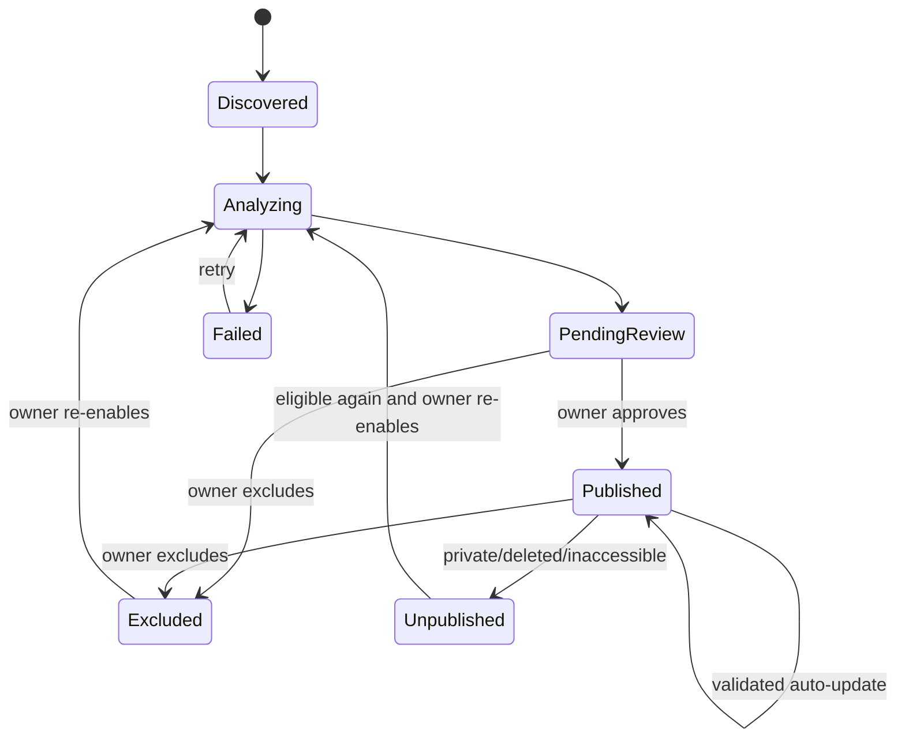

# MorphFolio — Persistence and Domain Model

**Status:** Initial single-owner GitHub-sync schema design  
**Database:** Neon PostgreSQL  
**ORM/migrations:** Drizzle ORM

## 1. Design principles

- GitHub's immutable repository ID is the external identity; repository names and URLs can change.
- One connected owner/installation in the initial release.
- Repository discovery is separate from project publication.
- A repository may exist without a public project.
- New projects require first-publication approval.
- Generated content, owner overrides, and published snapshots are separate records.
- Every synchronization and AI run is traceable to source revisions.
- Deletion/privatization immediately affects public eligibility but does not erase the minimum audit trail.
- Never store GitHub access tokens in ordinary repository/project rows or return them to the client.

## 2. Initial tables

### github_installations
One active installation in the first release. Store the immutable installation ID, account login/type/ID, non-secret permission snapshot, suspension and lifecycle timestamps. Generate short-lived installation tokens on demand from the server-side GitHub App private key; do not persist them as long-lived credentials.

### repositories
One row per immutable GitHub repository ID. Store installation FK, owner/name/full name, HTML URL, default branch, description, homepage, visibility, archived/fork/disabled flags, deleted/accessibility state, last observed commit SHA, last README SHA, metadata hash, last sync time/status, safe error code, analysis-enabled flag, and owner exclusion state. Private metadata may be recorded, but private README content is not submitted to an external AI provider unless explicitly enabled.

### projects
Portfolio identity and publication state associated with a repository. Store repository FK, stable unique slug, publication status (pending_review/published/excluded/unpublished), automatic-update preference, owner-controlled featured/sort order, current published version reference, and publication timestamps. Do not create a public project for every repository automatically.

### repository_snapshots
Bounded source snapshots: repository FK, commit SHA, README path/SHA/content where retention is permitted, metadata/evidence JSON, content hash, and capture time. Avoid retaining private README content unless the owner opts into private analysis. Define retention limits.

### ai_generation_runs
One record per analysis attempt: repository/project/snapshot references, model ID, prompt/schema versions, status, input hash, validated output JSON, usage, latency, safe error code, and timestamps.

### project_content_versions
Immutable generated or owner-edited content versions: project FK, generation run reference, version number, schema-validated content JSON, evidence references, source commit/README SHA, status (draft/published/superseded/rejected), creator (AI/owner/system), and creation time.

### project_overrides
Field-level owner edits that must not be overwritten by AI: project FK, allowlisted field path, JSON value, owner identity, and update time. Unique per project/field path. Reset deletes the override and exposes the latest generated value.

### webhook_deliveries
Minimal webhook delivery ledger: unique GitHub delivery ID, event/action, repository ID when available, receipt/processing status, timestamps, and safe error code. Do not retain full raw webhook payloads by default.

### sync_runs
Account-, repository-, or event-scoped synchronization execution: trigger type (initial/manual/webhook/reconciliation), status, source revision, start/end, retry count, and safe error code.

### owner_audit_events
Minimal record of owner approvals, exclusions, overrides, publication, connection, and disconnect actions. Store actor GitHub user ID, action, target, safe metadata, and timestamp. Never store secrets or private README excerpts.

## 3. Publication state machine

Repository status and project publication status are separate. A repository can be discovered, private, archived, or excluded without being publicly represented.

## 4. Override precedence

For each generated field:
1. Owner override, if present.
2. Latest validated AI-generated value.
3. Safe fallback/omission.

Featured status, manual ordering, owner profile facts, skill confidence, work history, education, and availability are owner-controlled and never inferred from README changes.

## 5. Public read model

Public project queries must return only projects where publication status is published, the linked repository is public, accessible, not deleted, and not disabled, and the current published version exists and passed validation. Enforce this in server-side data access, not only in frontend conditionals.

## 6. Indexes and constraints

- Unique GitHub repository ID and installation ID.
- Unique GitHub delivery ID.
- Unique project slug and project/repository association.
- Unique project/version number.
- Unique project/override field path.
- Index repository visibility/status and sync status.
- Index project publication status and slug.
- Index queued/failed jobs and event receipt time.

Use transactions for project creation, version promotion, unpublishing, and repository lifecycle transitions.

## 7. Retention and deletion

Do not retain private README content unless the owner opts into analysis. Bound public README snapshot size and retention. Retain minimal deletion tombstones to handle delayed webhook deliveries. Disconnect must revoke/uninstall the GitHub App and apply the documented retention policy to installation state, evidence, drafts, and audit events.
